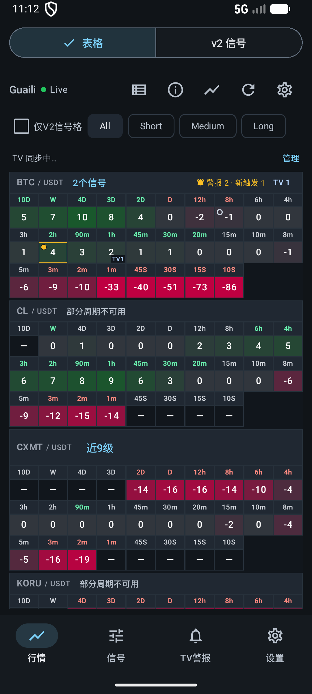
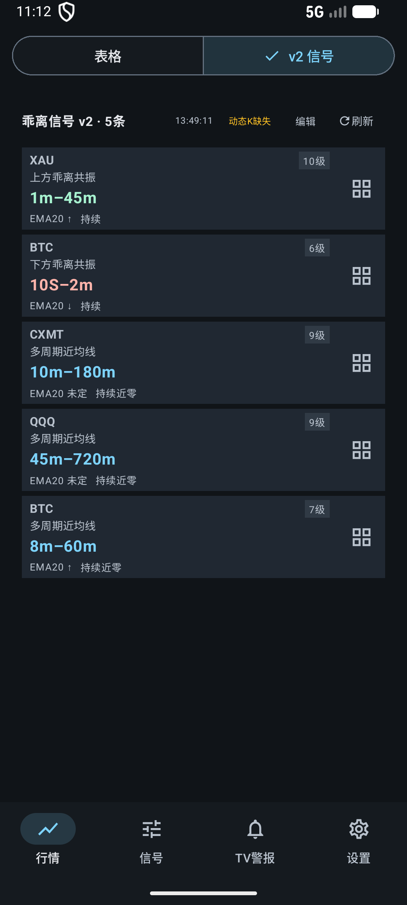
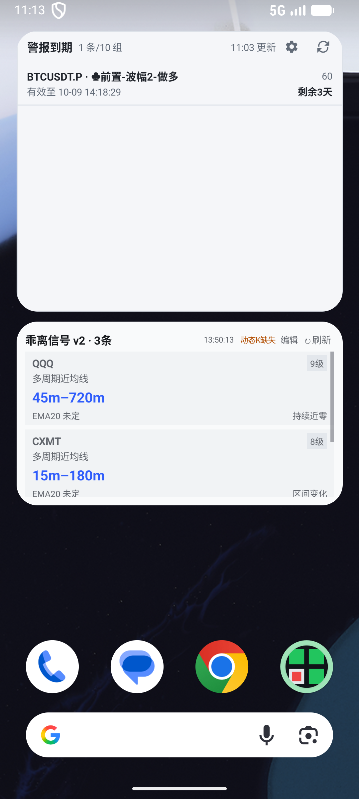

# Android 界面层次同步与验证

2026-10-11，用户确认同步桌面端的视觉主次，先记录规范，再修改 Android 主表格、V2 和桌面小组件。项目实际目录为 `F:/test/guili-andriod`。

## 长期规范入口

[AGENTS.md](../AGENTS.md) 已链接 [PRODUCT.md](../PRODUCT.md)、[DESIGN.md](../DESIGN.md) 及主表格、V2、小组件三份局部规范。页面任务决定重点：主表格看 guaili 值，V2 看真实结构参与周期。不同页面不统一放大全部级别，不套用回调观察窗口的多空配色。

## 实现

- 主表格与分组表格：品种标题、工具栏、筛选说明使用次级文字颜色和较轻字重。数值与周期字号、格宽格高、密度算法及原颜色映射保持不变。
- V2：真实周期范围独立成主行，16sp 加粗并使用原结构语义颜色。品种 12sp，结构说明 11sp，EMA、阶段、方向及级数 10sp，均退到辅助层。分歧的短段和长段分别展示完整范围、方向与级数。独立页和宽屏侧栏使用同一展示组件。
- 小组件：矩阵继续突出数值，弱化分组标题与编辑／刷新。V2 使用共享字号和范围／说明构造，保留日夜调色板、列表滚动和导航。窄组件的辅助信息分行，范围允许换行。
- 应用 V2 顶部常用操作保留至少 48dp 点击区域。保留详情展开、长按、K 线、表格定位、过滤、状态详情、选择清除、缓存与滚动恢复。

本次没有修改后端算法、数据有效性语义、网络轮询、后台调度或格子密度计算。提醒类小组件的条目展示保持原状。

## 验证

- Debug / Release 构建、Debug Lint 通过；当前 Lint 为 0 个错误、45 个警告。
- 应用单元测试 263 项通过，0 失败、0 错误。
- 最终手机回归 12 项通过：9 项行情界面测试、2 项小组件原生尺寸测试、1 项真实 V2 小组件状态导航。另跑矩阵小组件滚动到第 5 个品种，1 项通过。
- 150% 字体、系统深色环境：真实行情界面、180/250/320dp 原生信号卡片与真实 V2 桌面组件共 3 项通过。周期实际绘制字重大于辅助说明，范围、方向、EMA 与阶段没有省略；标题栏沿用单行展示，在较大字体时次级标题可能省略。
- 宽屏：真实行情表格与 V2、侧栏联动／清除／返回共 2 项通过。使用同一手机模拟器扩展为 1600×1000、160dpi；独立平板模拟器 ADB 授权未就绪，未声称完成独立平板验证。
- Android 原生截图来自 API 36.1 手机模拟器，正常尺寸 1080×2400、420dpi。测试设置、缓存与小组件配置恢复；字体、尺寸、密度与系统主题均恢复到测试前值。
- 最终 Release APK 已覆盖安装并冷启动成功，包无 DEBUGGABLE 标记。Manifest 的 36 个组件均在 3 个 DEX 中定义；APK v2/v3 签名验证通过。未进行真机性能测量。

真实行情截图连接现有服务器；动态 K 缺失、行情旧、过期与部分周期不可用提示如实保留。宽屏侧栏和分歧尺寸图使用测试数据验证字段及交互，不代表当时的真实信号。

## 效果图

主表格（真实行情）：

V2（真实行情）：

桌面小组件（下方为真实 V2）：

附加检查：[150% 字体](assets/ui-hierarchy/market-v2-live-phone-font-1.5.png)、[宽屏主表格](assets/ui-hierarchy/market-table-live-wide-final.png)、[宽屏侧栏联动](assets/ui-hierarchy/market-link-pane-wide-final.png)、[180dp 分歧卡片](assets/ui-hierarchy/signal-card-180-conflict.png)、[深色 150% 字体分歧卡片](assets/ui-hierarchy/signal-card-180-conflict-dark-font-1.5.png)、[矩阵小组件滚动](assets/ui-hierarchy/widget-matrix-live.png)。

## 安装包

Release 安装包：`dist/ui-hierarchy/GuailiAndroid-ui-hierarchy.apk`，版本 0.3.0 / versionCode 3。使用现有本机开发证书签名供审核安装，未使用生产发布证书。

SHA-256：`C21886FFDA6893B900DCB63D89F2D8D0FB749E31E50B345440F32D534360728B`。
